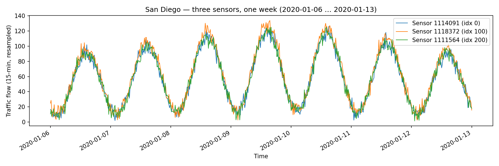
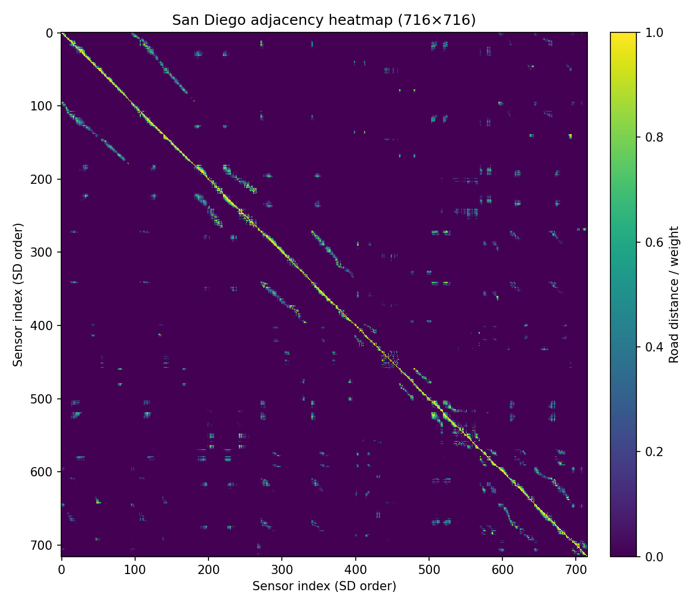
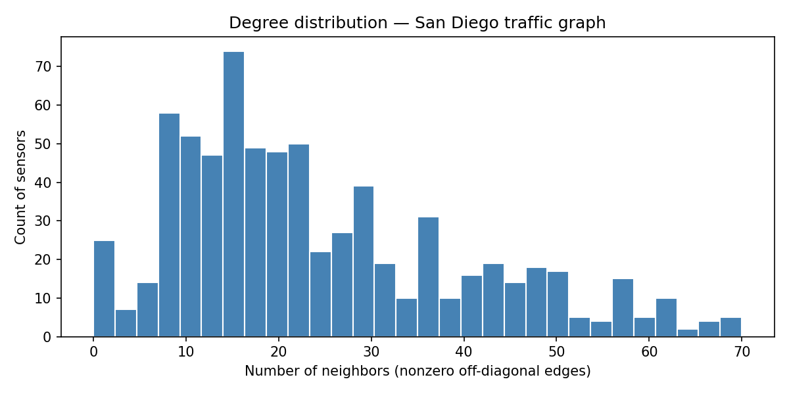

# Question 3 — Dataset Preparation and Graph Construction (LargeST San Diego)

Reference: [LargeST](https://github.com/liuxu77/LargeST) (NeurIPS 2023 DB Track). San Diego (SD) is **District 11** in `ca_meta.csv` (**716** sensors). Sensor order follows `sd_meta.csv` / `ID2` indexing into the CA adjacency matrix.

**Data note:** Flow was built from LargeST `ca_his_raw_2020.h5` and `ca_his_raw_2021.h5` via `scripts/fetch_real_flow_g.py` (one HDF5 at a time, chunked reads for RAM; intermediates on C: then copied to `data/processed/`). Metadata and \(A_{\mathrm{SD}}\) are from Kaggle LargeST.

---

## Q3(a) — Data extraction and resampling

### Procedure

1. Download the CA bundle from [Kaggle — LargeST](https://www.kaggle.com/datasets/liuxu77/largest) into `data/raw/`.
2. Select SD rows with `District == 11`, keep **716** sensor IDs (same order as `ID2` for the graph).
3. Load `ca_his_raw_2020.h5` and `ca_his_raw_2021.h5` (5-minute PeMS flow).
4. Resample to **15 minutes** with `pandas` rule `15min`.
5. **Aggregation choice:** PeMS flow is a **vehicle count per 5-minute interval**. The assignment allows **mean** (average rate over the window) or **sum** (total vehicles in 15 min). We follow the official LargeST `process_ca_his.ipynb`: **mean** of the three 5-min bins, then `round(0)`. This matches the benchmark; **sum** would preserve total count per 15-min window.
6. **Missing values:** Resampling can introduce NaNs when a bin has no observations. We report counts **before** `fillna(0)` (LargeST uses zero imputation for absent flow).

**Measured missingness (real LargeST run, `sd_flow_metadata.json`):**

| Statistic | Value |
|-----------|-------|
| Sensors with any NaN (pre-fill) | 716 / 716 |
| Total NaN cells (pre-fill) | 2,542,017 |
| NaN fraction of tensor cells | 5.06% |
| Imputation | `fillna(0)` after 15-min resample (LargeST convention) |

### Outputs

| Artifact | Description |
|----------|-------------|
| `data/processed/flow_15min.npy` | Flow tensor \(X \in \mathbb{R}^{T \times 716}\) |
| `data/processed/manifest.json` | Start time and frequency for Q4 loaders |
| `data/processed/sd_meta.csv` | Sensor metadata (aligned column order) |

### Figure



*Generated by `python -m src.data.run_q3` after raw data is present. Week shown: 2020-01-06 — 2020-01-13; sensors at indices 0, 100, 200.*

---

## Q3(b) — Traffic graph \(A_{\mathrm{SD}} \in \mathbb{R}^{716 \times 716}\)

### Construction

1. Load `ca_rn_adj.npy` (road-network distances / connectivity for all CA sensors).
2. Submatrix: \(A_{\mathrm{SD}} = A_{\mathrm{CA}}[I, I]\) with \(I =\) `sd_meta.ID2` (same order as flow columns).

### Required statistics

From `data/processed/sd_adjacency_stats.json` (diagonal zeroed for edge counts):

| Quantity | Value |
|----------|-------|
| Nodes | 716 |
| Off-diagonal nonzero (directed pairs) | **17,319** |
| Directed nonzero incl. diagonal (pre-strip) | 18,035 |
| Symmetric? | **No** (`max asymmetry ≈ 1.0` on the SD submatrix) |
| Mean degree (off-diagonal) | **24.19** |
| Sparsity (directed nonzeros / \(716^2\)) | **3.38%** |

### Figures





### Meaning of \(A_{ij} \neq 0\)

A nonzero \(A_{ij}\) means sensors \(i\) and \(j\) are **linked on the road network** within the LargeST construction (distance-based adjacency from the CA matrix), not merely geographically close. The value encodes **road-network distance** (or derived weight), so graph convolution passes information along plausible traffic routes.

---

## Q3(c) — Graph neighborhoods (example sensor)

**Concrete example** from `data/processed/q3c_neighborhood_example.json`:

| Field | Value |
|-------|-------|
| Sensor index / ID | **0** / **1114091** |
| Location | (32.544, −117.032) |
| One-hop count | **23** neighbours (indices and PeMS IDs in JSON) |
| Two-hop count | **23** additional sensors (not in one-hop) |

Neighbor lists after running the pipeline: `data/processed/q3c_neighborhood_example.json`.

### One-hop vs two-hop

- **One-hop:** \(\mathcal{N}_1(i) = \{ j : A_{ij} \neq 0 \}\) (direct road-network neighbors).
- **Two-hop:** nodes reachable from \(i\) with a path of **at most two edges**, excluding \(i\) and one-hop nodes.

### Written answers

**Why might neighboring sensors help predict traffic at the selected sensor?**  
Traffic is spatially coupled: congestion, incidents, and demand propagate along highways. Neighbors on the same corridor or at merges often **lead or lag** the target sensor, so their recent flow is predictive.

**What is the difference between one-hop and two-hop information aggregation?**  
**One-hop** layers combine only **direct** neighbors (local corridor effects). **Two-hop** aggregation (one layer on neighbors, or a 2-layer GCN) also uses **indirect** influence (e.g., congestion two links away that will arrive later). Two-hop widens the spatial receptive field but mixes information along longer paths.

**Could too many graph convolution layers hurt performance?**  
Yes. Deep GCNs risk **over-smoothing** (node features become similar), add **noise** from distant irrelevant sensors, and increase parameters / training difficulty. For SD, most useful signal is often **local** (1–2 hops); deeper stacks can dilute temporal detail unless combined with strong temporal modules or skip connections.

---

## How to reproduce

```bash
pip install -r requirements.txt
python -m src.data.download          # checks files; use --kaggle to download
python -m src.data.run_q3
```

Raw files required in `data/raw/`: `ca_meta.csv`, `ca_rn_adj.npy`, `ca_his_raw_2020.h5`, `ca_his_raw_2021.h5`.